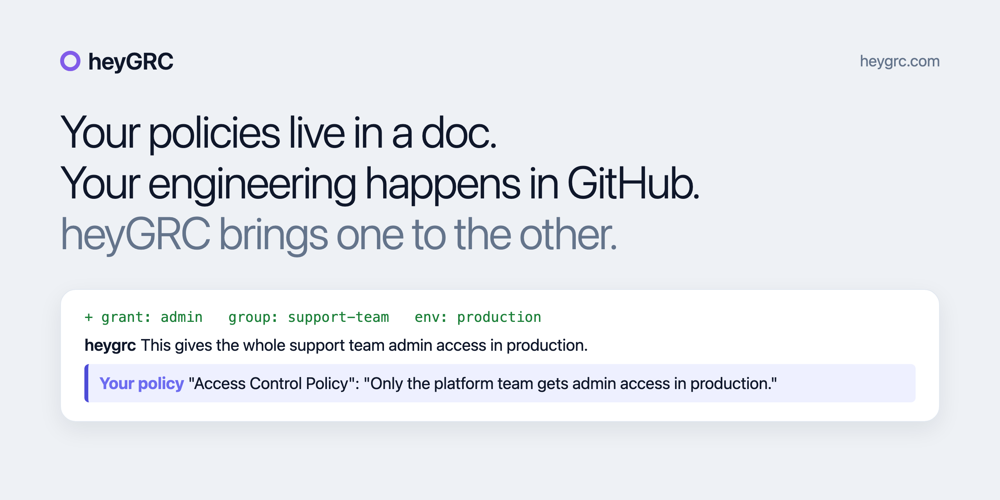

<picture>
  <source media="(prefers-color-scheme: dark)" srcset="assets/banner-dark.png">
  <source media="(prefers-color-scheme: light)" srcset="assets/banner-light.png">
  
</picture>

[](https://docs.heygrc.com/docs/pricing-and-plans) [](https://github.com/apps/heygrc) [](https://docs.heygrc.com/docs/team-rules) [](https://heygrc.com)

# heyGRC reviews your pull requests against your own policies.

Your policies stay where they already live. Your engineers stay in GitHub. When a change goes against one of your rules, heyGRC says so in the pull request, next to the line, quoting your own policy. It also checks the frameworks you select: ISO 27001, SOC 2, GDPR, the EU AI Act, DORA, NIS 2 and more.

The call stays with your team: heyGRC never blocks a merge.

By [Better ISMS](https://heygrc.com).

This plugin does **not** review code on your machine. It is a setup skill that installs and
configures the [heyGRC GitHub App](https://github.com/apps/heygrc). Reviews run server-side.

## Install

### Claude Code

```
/plugin marketplace add better-isms/heygrc-plugin
/plugin install heygrc@heygrc
```

Then run `/heygrc:review`.

### Cursor

Load the repo as an Agent Plugin (root `plugin.json`) from Customize, or submit/install from
the Cursor Marketplace once listed. Local test: symlink this repo into `~/.cursor/plugins/local/heygrc`.

### Codex CLI

```
codex plugin marketplace add better-isms/heygrc-plugin
```

Then `/plugins` and install `heygrc`.

### GitHub Copilot CLI

Copilot CLI reads `.claude-plugin/marketplace.json`:

```
copilot plugin marketplace add better-isms/heygrc-plugin
copilot plugin install heygrc@heygrc
```

### Any Agent Skills client

```
npx skills add better-isms/heygrc-plugin
```

### Gemini CLI

```
gemini extensions install https://github.com/better-isms/heygrc-plugin
```

Also indexed in the Gemini CLI extension gallery (geminicli.com/extensions).

After install, ask the agent to set up heyGRC compliance review. Full steps: [SETUP.md](./SETUP.md).

## Where it is listed

- OpenAI / ChatGPT Plugins Directory: https://chatgpt.com/plugins/plugins_6a886769f0fc8191a0d42669abca1f98
- skills.sh: https://skills.sh/better-isms/heygrc-plugin
- SkillsMP (auto-indexed)
- The [heyGRC GitHub App](https://github.com/apps/heygrc) itself is on the GitHub Marketplace: https://github.com/marketplace/heygrc

## What it does

heyGRC runs as a GitHub App, so reviews happen server-side, not on your machine. It reads your rules
from two places:

- **Your policy documents**, linked once in the console (a link, or the folder where they live). On each
  pull request it picks the rules that apply and quotes them in the finding.
- **Team rules** in a `.heygrc.md` file in the repo, written as controls. See
  [team rules](https://docs.heygrc.com/docs/team-rules).

On each pull request it posts:

- **Inline findings** on the exact lines that touch a compliance obligation, each with a control
  reference and a short reason.
- **A neutral check run.** heyGRC never fails a check or blocks a merge.
- **One sticky summary comment per PR**, updated in place.

## Pricing

- **Public repositories:** free, up to 500 reviews per organization per month.
- **Private repositories:** free for 10 pull requests a month. Claiming your install starts a 14-day
  trial with up to 500 private PR reviews, no card. Paid plans start at $39 a month.

See [pricing and plans](https://docs.heygrc.com/docs/pricing-and-plans).

## Links

- Website: https://heygrc.com
- Docs: https://docs.heygrc.com
- Setup with your agent: https://docs.heygrc.com/docs/setup-with-an-agent
- Privacy policy: https://trust.ismscopilot.com/en/privacy-policy
- Terms: https://trust.ismscopilot.com/en/terms
- Support: support@ismscopilot.com

## License

MIT. See [LICENSE](./LICENSE).
